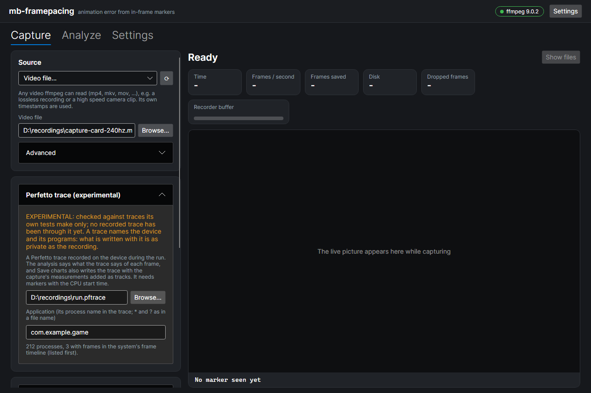
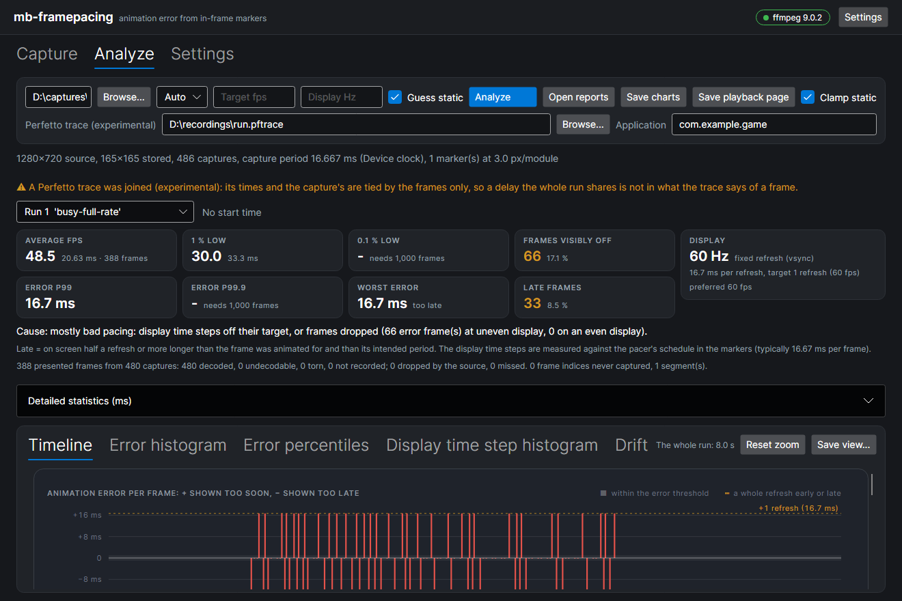

# A capture and a Perfetto trace of the same run (experimental)

> **Experimental.** Built against traces its own tests make, by our reading of Perfetto's formats. **No recorded trace has been
> through it yet**: how it matches the system's frames to the capture's, and where it finds a display's vertical blanks, is
> unproven until one has. Its options and its output may change.

A capture card records what the display was sent, and the tools measure when each frame was really on screen. A
[Perfetto](https://perfetto.dev) trace recorded on the device at the same time has what the system did meanwhile: its threads,
its compositor, its own account of every frame. The tools join the two, both ways, by
[the frame record](../../sdk/doc/trace-frame-record.md) the application logs into the trace:

- **The trace into the capture's frames:** the analysis says what the trace says of each presented frame. The report card says
  that a trace was joined, the GUI shows the trace's lines for the frame under the pointer, and a CSV has a line per frame.
- **The capture into the trace:** a copy of the trace with the capture's measurements added as tracks (the augmented trace), to
  open in [the trace viewer](https://ui.perfetto.dev) next to everything the system recorded.

Neither input is changed and nothing is uploaded: the viewer reads a trace in the browser, on your machine.

**A trace names the device and its programs.** The augmented trace holds everything the recorded one did, and the per-frame CSV
has the application's layer name. Keep both as private as the recording: this repository holds no recorded trace, and its tests
make their own. Nothing of a trace that names a program or a device is put on a report card.

## What it needs

- A recording of the run, imported and analysed as [the usage guide](usage.md) describes.
- A Perfetto trace of the same run, in Perfetto's protobuf format (`.pftrace`, `.perfetto-trace`; a whole-file gzip is taken too).
- **The frame record in that trace**: a slice the application logs for each frame, named for the frame's marker, from the
  marker's CPU start time for its CPU busy time. [The SDK defines it](../../sdk/doc/trace-frame-record.md), with every string,
  and its trace module works out what to log from a marker's payload. **A trace without it is not joined**: the frames are
  placed by it. So the markers need the CPU start time too, and best the pacer's intended display time
  ([the marker's fields](../../sdk/doc/marker-fields.md)).
- **Perfetto's trace processor** (`trace_processor_shell`), a native program that reads the trace. It is yours: the tools start
  it as a separate process that listens on this machine only, and never bundle or download it. Each
  [Perfetto release](https://github.com/google/perfetto/releases) has a zip per system that holds it. The tools look for it in
  this order: `--trace-processor`, the environment variable `MB_TRACE_PROCESSOR`, `traceProcessorPath` in the configuration file
  (`config --experimental --set-trace-processor <path>`, or the GUI's Settings page), the `PATH`, and the folder Perfetto's own
  Python package keeps the copy it downloaded in.

## On the command line

Everything here needs `--experimental`, and is left out of `--help` without it.

```
mb-framepacing --experimental trace-info run.pftrace
mb-framepacing --experimental import recording.mkv --trace run.pftrace --analyze --charts
mb-framepacing --experimental analyze <capture folder> --trace run.pftrace --charts
```

1. `trace-info` lists what a trace has to go by: how many slices of the frame record it has, its clocks, its vertical blank
   sources, its processes (those the system's frame timeline has frames of first), their layers and, with `--trace-process`,
   their threads. Start here: a trace with no frame record can not be joined.
2. `import --trace` stores the trace and its options with the capture (`capture.json`), so every later analysis joins it again.
3. `analyze --trace` joins a trace for that analysis; `--no-trace` joins none, also when the capture names one.
4. `--charts` also writes the augmented trace, and reads it back to check that every track has what was written.

| Option                           | What                                                                                                                              |
| -------------------------------- | --------------------------------------------------------------------------------------------------------------------------------- |
| `--trace <file>`                 | The trace                                                                                                                         |
| `--trace-app <file>`             | A trace the application wrote itself, when the frame record is in a file of its own ([below](#two-traces))                        |
| `--trace-process <pattern>`      | The application's process name in the trace (`*` and `?` as in a file name). Unset: the process the frame record is on            |
| `--trace-layer <pattern>`        | The application's layer in the frame timeline, when it has several                                                                |
| `--trace-thread <name>`          | The thread whose CPU time is counted: the process's main thread unless named                                                      |
| `--trace-vblanks <name>`         | Which of the trace's vertical blank sources to use, or `none`. Unset: the kernel's vertical blank events, when the trace has them |
| `--trace-capture-offset-ns <ns>` | The capture's clock minus the application's, when you know it: nothing is worked out from the frames then                         |
| `--trace-processor <path>`       | The `trace_processor_shell` to read the trace with                                                                                |

**Whether a trace exists.** An application that logs the frame record can say so in the run's start marker
([its flags](../../sdk/doc/marker-fields.md#flags-frame-record-logged-experimental)). The analysis then notes with the run that
the application logged its frames to a trace, and, when no trace was joined, that one can be merged with the capture. It is the
application's word: nothing is judged by it, and a trace is joined with or without it. A trace that is given and not joined with
such a run gets a line more in its warning, asking whether it is the trace of that run.

A `--trace` or `--trace-app` file that is not there, or no trace processor, stops the command before it starts. What does not
fit later is a warning, and the analysis is written without the join: a trace that has no frame record of a run, a run whose
times are not inside the trace, or a trace the capture remembers that has gone since.

### Two traces

An application that logs through the system's tracing has its frame record in the trace of the system. One that writes a trace
file of its own has the record there, and nothing of the system in it. Both work:

- **The application's trace alone** is given as `--trace`: its frames are placed in it, and the augmented trace is the
  application's trace with the capture's measurements added. What the system did is not in such a trace.
- **A trace of the system and one of the application**: `--trace <system> --trace-app <application>`. The frame record is read
  from the application's file and the run is placed in the system's trace by it. Both traces need a snapshot of the monotonic
  clock, which is what ties the two files.
- `--trace-app` alone joins nothing: the markers are only [held against the record](#do-they-line-up).

## In the GUI

With **Settings → Experimental features** on:

- The **Capture** page has a **Perfetto trace** card: the trace's file, and the application, picked from the trace's processes
  once the trace is read. The trace is stored with the capture.
- The **Analyze** page shows the capture's trace in a row of its own, and the next **Analyze** joins what the row says: the
  capture's trace, another, or none.
- **Save charts** also writes the augmented trace.
- The **Settings** page shows the trace processor in use, and takes yours.





The application may be left empty: it is the process the frame record is on. The other options of the join (the layer, the
thread, the vertical blank source) and a second trace of the application's own are the command line's; a capture imported
there keeps them when the GUI analyses it.

## What the analysis writes

Next to the run's frames, in the capture's `analysis` folder. Both files are the tools' own and experimental: they are not part
of [the analysis output format](../../sdk/doc/analysis-output-format.md).

| File                         | What                                                                                 | Written                                                                        |
| ---------------------------- | ------------------------------------------------------------------------------------ | ------------------------------------------------------------------------------ |
| `run-<id>-trace.csv`         | A line per presented frame with what the trace says of it ([below](#the-frames-csv)) | By every analysis that joined the run                                          |
| `run-<id>-trace-check.txt`   | How well the markers and the trace line up, as numbers ([below](#do-they-line-up))   | By every analysis that joined the run, or read only an application's own trace |
| `run-<id>-augmented.pftrace` | The trace with the run's measurements added as tracks ([below](#the-tracks))         | With the charts: `--charts`, **Save charts**                                   |

An analysis that joins no trace removes the files an earlier one left. The augmented trace is a copy of the whole trace, so it is
written when you ask for the charts and not by every analysis.

## On the report card and under the pointer

The report card's description gets two lines: that a Perfetto trace was joined and what its times rest on, and for how many of
the card's frames the trace has the system's own account, its thread's scheduling and a vertical blank.

In the GUI, the text for the frame under the pointer gets the trace's lines, each only when the trace has the value:

| Line                                                                   | What                                                                                                    |
| ---------------------------------------------------------------------- | ------------------------------------------------------------------------------------------------------- |
| `trace, the system's frame timeline: <present type>, jank <jank type>` | What the system's frame timeline calls the frame, in its own words                                      |
| `trace, display time minus the system's present time`                  | The measured display time minus the time the system says the frame was presented                        |
| `trace, CPU busy on its thread: running, waiting for a CPU, neither`   | Of the marker's CPU busy time, how long the thread was running, waiting for a CPU, and neither (asleep) |

The difference between the measured display time and the system's present time carries the limit of [the clocks](#the-clocks):
its changes from frame to frame are exact, a constant part of it is not.

## The clocks

Three clocks meet: the capture's, the application's, which the markers' times are on, and the trace's.

| Step                                             | From                                                                                                                                                                                                                                 | How sure                                                                                                                                                                       |
| ------------------------------------------------ | ------------------------------------------------------------------------------------------------------------------------------------------------------------------------------------------------------------------------------------ | ------------------------------------------------------------------------------------------------------------------------------------------------------------------------------ |
| The application's clock to the trace's           | The frame record: each frame's CPU work is where its slice is. The median of slice start minus the marker's CPU start time is what a marker's time needs added, and it is 0 when the marker's times are read from the record's clock | Given by the application, frame by frame. The numbers say how many frames are off it, and a run is not joined when fewer than half of its CPU start times lie inside the trace |
| The capture's clock to the application's         | The analysis's own alignment, from the run's frames. Without intended display times: no frame is on screen before its CPU work ended                                                                                                 | The differences between frames are exact. Where the whole run sits rests on its on-time frames                                                                                 |
| A finer position, on the trace's vertical blanks | The measured display times are whole refreshes apart, so all of them are moved by the one part of a refresh that puts them on the trace's vertical blanks                                                                            | Which refresh is not from it. The script below prints how many frames then have a vertical blank within half a refresh, and how far the furthest is                            |

**What this can not tell.** The frame record ties the application to the trace, not the capture card to the application: a
delay that the whole run shares can not be told from the difference between those two clocks. When every frame of a run is a
refresh behind its plan, the tracks are a refresh early against the trace. Differences between frames (a frame that stayed a refresh
longer, a late frame) are exact. The marker's fields have the same limit and say so.

## Do they line up

Every join works out how well the run's markers and the trace line up, three ways that do not depend on each other. `analyze`
prints the numbers, and they are written next to the run's frames as `run-<id>-trace-check.txt`.

| Check                                                 | What lines up looks like                                                                                                                                                                                             | Needs in the trace                     |
| ----------------------------------------------------- | -------------------------------------------------------------------------------------------------------------------------------------------------------------------------------------------------------------------- | -------------------------------------- |
| CPU busy against the thread's scheduling              | The application's thread is running, or waiting for a CPU, for the markers' CPU busy time. The same is worked out with every frame matched a frame earlier and a frame later: where frames' work differs, it is less | Scheduling events                      |
| Measured display time minus the system's present time | The same for every frame, a late one too: each frame of the capture is then the frame of the trace it was matched to. The number of frames more than half a refresh from the median says how many are not            | Android's frame timeline               |
| The markers against the frame record                  | Every value the tools decoded from a frame's marker is the value the application logged for that frame: no difference, to the nanosecond                                                                             | The frame record, which every join has |

**The markers against the frame record**, for each run, by the marker's run id and frame index:

- how many of the frames with a CPU start time have a slice;
- the median of slice start minus the marker's CPU start time, which the run is placed by, and for how many frames the slice
  starts elsewhere, with the smallest and the largest difference from it;
- for how many frames the slice's length is not the marker's CPU busy time, with the median, the smallest and the largest;
- for each annotation the slices have, for how many frames it is not the marker's value.

An application that logs the payload's own numbers, as the SDK's trace module gives them, has no difference anywhere: anything
else is a finding, such as a marker decoded as another frame's, or a value lost on the way. One that can only log a section
live, around the work, is close, and the numbers say how close.

**Numbers only.** What is usual for them is not known until recorded traces have been through it, so nothing says pass or fail.
And none of the three shows a delay the whole run shares ([the clocks](#the-clocks)).

## The tracks

Under one track named `mb-framepacing: <run>`, in this order. A slice's arguments have its values.

| Track                          | What                                                                                                      |
| ------------------------------ | --------------------------------------------------------------------------------------------------------- |
| On screen (measured)           | A slice per frame from its display time for its time on screen, named `#<frame index>`                    |
| Intended display (the pacer's) | A slice per frame from its intended display time to the next frame's                                      |
| CPU (from the markers)         | A slice from a frame's CPU start time for its CPU busy time, with an arrow to the frame's slice on screen |
| Animation error (ms)           | A value per frame: animation time step minus display time step                                            |
| Display time step (ms)         | A value per frame: how long the frame before it stayed                                                    |
| Lateness (ms)                  | A value per frame: how long after its intended display time it was shown                                  |
| Frame events                   | Late frames, frame indices that were skipped, frames out of order, torn frames                            |
| Capture events                 | The capture's own gaps: captures not decoded, not recorded, dropped by the source or missed               |

The terms are [the vocabulary's](../../sdk/doc/vocabulary.md), and a name says what the capture's data says and no more: a frame
index that was skipped is not called dropped.

The same capture and the same trace give the same bytes. What is added has packet sequences, track ids and arrow numbers of its
own, made from the run and the track's name.

**The tracks are written before the trace's own packets, with their times on the trace's own clock.** A reader takes a long
recording, one that was written to its file in pieces, piece by piece, and leaves out what comes after the last piece with a
time from an earlier one: added to the end of a test trace with two such marks, a third of the tracks' events were gone. Before
the first piece nothing is too late.

## The frames CSV

A header line, then a line per presented frame in display order. Every time is whole nanoseconds on the trace's clock, and a
cell is empty where the trace does not say. Each group of columns is filled when the trace has what it needs.

| Columns                                                                                                                                                                              | What                                                                                                                                                                                | Needs in the trace       |
| ------------------------------------------------------------------------------------------------------------------------------------------------------------------------------------ | ----------------------------------------------------------------------------------------------------------------------------------------------------------------------------------- | ------------------------ |
| `frameIndex`, `displayTraceNs`, `cpuStartTraceNs`, `cpuEndTraceNs`                                                                                                                   | The frame: its display time as measured, and its marker's CPU start time and the end of its CPU busy time                                                                           | The frame record         |
| `vblankTraceNs`, `displayMinusVBlankNs`                                                                                                                                              | The vertical blank nearest the display time (within half a refresh), and how far the display time is from it                                                                        | A vertical blank source  |
| `surfaceFrameToken`, `displayFrameToken`, `layerName`, `presentType`, `jankType`, `jankTag`, `onTimeFinish`, `gpuComposition`, `systemPresentTraceNs`, `displayMinusSystemPresentNs` | The system's own account: the application's frame in the frame timeline, what the system says of it, when it says the frame was presented, and the measured display time minus that | Android's frame timeline |
| `cpuRunningNs`, `cpuRunnableNs`, `cpuSleepingNs`                                                                                                                                     | Of the frame's CPU busy time, on one thread: running, waiting for a CPU, and neither                                                                                                | Scheduling events        |

**Which of the system's frames is a frame of the capture is worked out from times**: the application's frame in the frame
timeline whose time the end of the capture frame's CPU work lies in, with that CPU work placed by the frame record. The
system's frame timeline has no id of ours. This is the part a recorded trace has to prove.

`displayMinusSystemPresentNs` is the reason for the file: **where the system's own account of a frame and the measured one
differ**.

## The script

`tools/trace_augment.py` does the same with [uv](https://docs.astral.sh/uv/) and Perfetto's own Python package (the group
`trace` of `pyproject.toml`), from a checkout of this repository. The tools' join is a port of it, and the two are held to the
same bytes by tests on both sides (`measure/test-data/trace`). It also does what the tools do not:

```
uv run --group trace tools/trace_augment.py --inspect run.pftrace
uv run --group trace tools/trace_augment.py <capture folder> run.pftrace -o run-augmented.pftrace
uv run --group trace tools/trace_augment.py <capture folder> run.pftrace --frames run-frames.csv
uv run --group trace tools/trace_augment.py <capture folder> -o run-capture.pftrace
uv run --group trace tools/trace_augment.py <capture folder> run.pftrace -o part.pftrace --from 10 --to 20
```

- Without a trace, `-o` writes the capture alone as a trace: the same tracks, on the capture's own clock.
- `--from` and `--to` take a stretch of the run, in seconds from its first frame.
- `--run <id>` picks a run of a capture with several; the tools join every run.

It needs the frame record in the trace as the tools do, and reads one trace: it has no `--trace-app`, and it does not hold
the markers against the record. Its options are the tools' without the `trace-` in front (`--process`, `--layer`, `--thread`,
`--vblanks`, `--capture-offset-ns`, `--trace-processor`). The package downloads the trace processor on first use (a pinned
version, checked against its SHA-256, kept under your home folder); that download needs `curl`.

## Limits

- No recorded trace has been through it.
- The vertical blank sources it finds are the kernel's vertical blank events and counters with `VSYNC` in their name. Which
  counter is the display's own is not something it knows: `trace-info` lists them and `--trace-vblanks` picks one.
- That every track is read back whole is checked with the trace processor, on traces the tests make (one of them with the marks
  of a recording written in pieces). The viewer uses the same reader, but nothing here has looked at a trace in the viewer.
- The frame record has been read from traces the tests make only, as the rest has: one with sections on the application's
  thread, one with slices on the record's own track.
- The system's frames are matched to the capture's by time ([above](#the-frames-csv)): the frame record places the
  application's work, and the system's frame timeline has no id of ours.
- The GUI has no field for a second trace of the application's own: it is the command line's.
- A trace is copied whole into each run's augmented trace.
- The trace's values are in the hover and the description only: no panel draws them yet.
