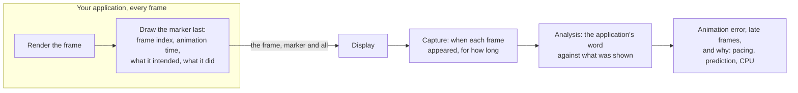
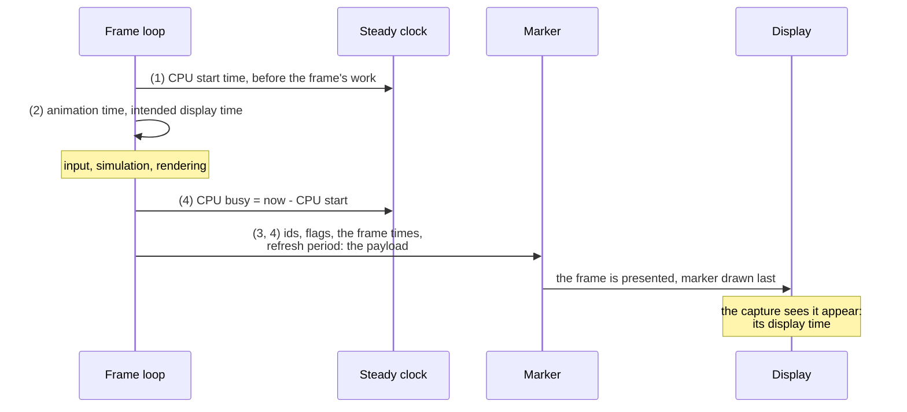

# Logging with the marker: getting the most out of it

[Integrating the marker](integrating.md) gets a marker on screen; [Filling the marker fields](marker-fields.md) says what every
field means. This guide is the one in between: it walks through a frame loop and shows **where in it each value is read, from
which clock, and on which platform**, so that every field the marker carries is filled, and what each one adds to the report. The
examples are C++ (`mb_framepacing::marker`); the C# and Python libraries take the same values in the same order.

> **Photosensitivity.** The marker is a high-contrast pattern that changes every frame. Draw it in test builds only, no larger
> than the capture needs, and tell the people at the screen before a run: see
> [Integrating the marker](integrating.md#photosensitivity) for the numbers.

## The idea

A capture sees only the display: which frame was on screen at each refresh, and when it first appeared. It can not see which
frame that was, what moment the frame's animation shows, or what the application meant to happen. The marker carries that, the
application's word, drawn into the frame itself:

- **The frame index** says which frame the capture sees, so the analysis knows when a frame was dropped, shown twice or out of order.
- **The animation time** says what moment the frame shows. The analysis lines up its steps with the display's: a frame that stays
  on screen longer than it was animated for is a visible stutter. That difference, the animation error, is the report's main number.
- **Every other field** is what the application intended (the frame rate it wants and aims for, when it meant the frame to be
  shown, the display it works with) or did (when its CPU started on the frame and how long it worked), so the report can say
  **why** a frame was off, not only that it was.



Because the values travel inside the frame, they can not go out of step with what was displayed: there is no log to fetch from the
device and nothing to line up by hand. The [start and end markers](#the-run-start-and-end-markers) say which frames are the run.

## What each field adds

Only the frame index and the animation time are required. Each further field is optional, and each one makes the report say
more. Add them in this order: each step builds on the one before.

| You fill                                     | The report gains                                                                                                                                                        |
| -------------------------------------------- | ----------------------------------------------------------------------------------------------------------------------------------------------------------------------- |
| Frame index, animation time                  | The animation error and the drift, display time steps, frame rates and lows, dropped and out-of-order frames; late frames measured against one refresh                  |
| + preferred and target frame time            | Late frames measured against what you aimed for, display time steps off their target, the late share's amber (slower than you want), on-demand frames that are not late |
| + intended display time                      | Every animation error split into pacing error (shown off the plan) and prediction error (animated for another moment), and each frame's lateness against the plan       |
| + CPU start time and CPU busy                | The frametime panel, CPU wait, the frame timeline card's CPU boxes, and a Perfetto trace of the run can be joined ([Logging to a trace](trace-logging.md))              |
| + refresh period                             | A warning, on the report card too, when the display you work with and the capture disagree: a capture card at another rate is caught                                    |
| + static flags                               | An idle screen or a paused menu is neither an error nor a slow frame rate                                                                                               |
| + start and end markers, a frame record flag | The analysis measures exactly the run you marked, with its name and start time, and knows a trace of it exists                                                          |

## The clocks

Every time is a whole number of nanoseconds, and the fields come from two clocks ([the clocks](marker-fields.md#the-clocks)):

- **The animation clock** gives the **animation time**: whatever your motion follows (the game's time, scaled and paused as the
  game does). The analysis compares its steps with the display's.
- **One steady clock** gives the **intended display time** and the **CPU start time**, and CPU busy is measured on it. Any epoch,
  but one clock for the whole run, and **the clock your platform's present timing uses**, so an intended display time from the
  platform needs no conversion:

  | Platform                 | Steady clock                                | In the SDK                                                                                       |
  | ------------------------ | ------------------------------------------- | ------------------------------------------------------------------------------------------------ |
  | Linux, Android           | `clock_gettime(CLOCK_MONOTONIC)`            | `FP::NanosecondTickCount(seconds * 1'000'000'000 + nanoseconds)`                                 |
  | Windows                  | `QueryPerformanceCounter`                   | `FP::NanosecondTickCount::FromCounter(counter, frequency)`                                       |
  | macOS, iOS               | `mach_absolute_time` (`CACurrentMediaTime`) | the counter converted with `mach_timebase_info`, or `CACurrentMediaTime()` in seconds × 10⁹      |
  | Anything with `<chrono>` | `std::chrono::steady_clock`                 | `FP::ToNanosecondTickCount(std::chrono::steady_clock::now())` (`core/time/ChronoConversion.hpp`) |

  `0` means unknown in these fields: a clock that can read exactly 0 (a counter that starts with the process) needs an offset.
  On Linux and Android, `CLOCK_MONOTONIC` is also the clock a [Perfetto trace](trace-logging.md) of the run is joined on.

## The frame loop

A frame loop that fills every field. Each numbered comment is explained below it; `Platform` stands for your engine's calls.
When each value is read, in one frame:



```cpp
#include <mb/framepacing/core/time/NanosecondTickCount.hpp>
#include <mb/framepacing/core/time/NanosecondTimeDuration.hpp>
#include <mb/framepacing/core/time/NanosecondTimeSpan.hpp>
#include <mb/framepacing/marker/FrameMarker.hpp>
#include <mb/framepacing/marker/geometry/ModuleMatrix.hpp>
#include <mb/framepacing/marker/payload/Payload.hpp>
#include <mb/framepacing/marker/payload/StartMetadata.hpp>

namespace FP = MB::FramePacing;
namespace FM = MB::FramePacing::Marker;

void Frame()
{
  // (1) The CPU starts on the frame: before input, simulation and building the commands
  const FP::NanosecondTickCount cpuStart = Platform::SteadyNow();

  // (2) What the frame is animated for, and what the pacer plans for it
  const FP::NanosecondTimeSpan animationTime = Game::AnimationTime();
  const FP::NanosecondTickCount intendedDisplay = Pacer::IntendedDisplayTime();   // 0 when you have no plan

  Game::Update(animationTime);
  Game::Render();

  // (3) The frame's ids and flags
  const uint64_t frameIndex = m_frameIndex++;                                      // every rendered frame, never reset in a run
  const FM::MarkerKind kind = Run::KindOf(frameIndex);                             // start, frame or end (below)
  FM::MarkerFlags flags = Game::NothingPending() ? FM::MarkerFlags::StaticAfter : FM::MarkerFlags::NoFlags;
  if (kind == FM::MarkerKind::SequenceStart && Trace::IsLogging())
  {
    flags = flags | FM::MarkerFlags::FrameRecordLogged;
  }

  // (4) The marker is drawn last, just before the present: CPU busy is measured now
  const FP::NanosecondTimeDuration cpuBusy(Platform::SteadyNow() - cpuStart);
  const FM::Payload payload(kind, Run::Id(), frameIndex, flags, animationTime,
                            Pacer::PreferredFrameTime(),   // what you want to run at
                            Pacer::TargetFrameTime(),      // what you aim for now
                            Platform::RefreshPeriod(),     // the display you work with; 0 under variable refresh
                            intendedDisplay, cpuStart, cpuBusy);
  FM::GenerateModules(payload, m_matrix, Run::StartMetadata());   // the metadata only goes into a start marker
  Renderer::DrawMarker(m_matrix);                                   // integrating.md, step 3
  Trace::LogFrameRecord(payload);                                   // optional: trace-logging.md

  Platform::Present(intendedDisplay);
}
```

### (1) CPU start time

Read the steady clock **before the frame's work begins**: before input is read, the simulation steps and the commands are built.
That is PresentMon's `CPUStartTime`, and the frametime is the step from one frame's CPU start to the next one's. A loop that waits
(for a present, the GPU or a time to start) reads it **after** the wait: the wait belongs to the frame before, and shows as CPU
wait, the frametime minus CPU busy. With several frames in flight, the next frame's CPU start may come before this frame's present;
that is expected, and the frame timeline card draws such frames in further lanes.

### (2) Animation time and intended display time

**The animation time** is the time the frame's animation is evaluated for: the same value your animation code used, not a clock
read while drawing the marker. A fixed-step simulation that renders without interpolation writes the simulation time the frame
shows. A game paused or in slow motion keeps its animation clock as the motion does, and flags the pause as static (3).

**The intended display time** is when the frame is meant to become visible, on the steady clock (1). It is the plan, known before
the present:

| You have                                                                                                           | The intended display time                                                                                                                      |
| ------------------------------------------------------------------------------------------------------------------ | ---------------------------------------------------------------------------------------------------------------------------------------------- |
| The SDK's [frame pacer](pacer.md) (experimental)                                                                   | `schedule.IntendedDisplayTime`                                                                                                                 |
| A present at a time: Vulkan `VK_EXT_present_timing` or `VK_GOOGLE_display_timing`, `EGL_ANDROID_presentation_time` | the time you ask the present for (`desiredPresentTime` in display timing)                                                                      |
| A predicted display time from the platform: Android's Choreographer, OpenXR, `CADisplayLink`                       | the time it gives (`AChoreographerFrameCallbackData_getFrameTimelineExpectedPresentationTimeNanos`, `predictedDisplayTime`, `targetTimestamp`) |
| Your own pacer on a vsync grid                                                                                     | the vsync you aim the frame at                                                                                                                 |
| Nothing of the kind                                                                                                | `0`: leave it unknown rather than guess                                                                                                        |

A game that animates for the predicted display time writes it as both the animation time and the intended display time: its
prediction error is then 0, and every error the analysis finds is pacing.

### (3) Frame index, run and flags

- **The frame index** counts rendered frames: one more for every frame made, the frames that never reach the screen included. Never
  count refreshes or game loop ticks, and never reset it inside a run.
- **The run id** is the same for a run's start, frame and end markers; give every run its own, and a new one after a restart.
- **Static after** goes on a frame when nothing animates while it is on screen (no pending work: an idle screen, a paused menu).
  An application that only knows it on the next frame (it woke up on input) sets **static before** on that next frame instead.
  Pause the animation clock **after** the last frame that moves.
- **Frame record logged** goes on the run's **start marker** when the run's frames are logged to a trace
  ([Logging to a trace](trace-logging.md)).

### (4) CPU busy, the frame times and the refresh period

**CPU busy** is the time from the CPU start (1) to now: draw the marker last, measure it as you draw it, before the present. It
does not include the GPU's work or time blocked in the present.

**The preferred frame time** is what the application wants to run at, **the target frame time** what its pacer aims for now: the
same, unless the pacer runs slower than you want. A 30 fps lock prefers 30 fps; a pacer dropping from 60 to 30 for a busy stretch
keeps preferring 60 and targets 30; an idle device at 1 fps prefers and targets 1 fps. An application that presents only when
something changes writes `FM::Payload::OnDemandFrameTime` in both.

**The refresh period** is the display you work with:

| Platform              | Where it comes from                                                                                                              |
| --------------------- | -------------------------------------------------------------------------------------------------------------------------------- |
| The SDK's frame pacer | `schedule.RefreshPeriod`: the period you gave it (`PacerSettings`), whether it paces or not                                      |
| Vulkan                | `VK_EXT_present_timing`'s or `VK_GOOGLE_display_timing`'s refresh duration, where the swap chain has the extension               |
| Windows (DXGI)        | the output's display mode (`DXGI_MODE_DESC::RefreshRate`, a fraction: keep it one, 60000/1001 is 16'683'333 ns), or DWM's timing |
| Android               | the Choreographer's refresh rate callback (`vsyncPeriodNanos`), or the display's refresh rate                                    |
| macOS, iOS            | `CADisplayLink`'s `duration`                                                                                                     |
| Unity                 | the helper fills it from `Screen.currentResolution` ([Unity](unity.md))                                                          |

Take it from **the display the window is on**: an API that reports the desktop's fastest display gives a period the capture will
not agree with, and the analysis says the two disagree. Under variable refresh there is no one period: write `0`. A rounded
whole-Hz rate (60 Hz for 59.94 Hz) is 0.1 % off, inside the analysis's 1 %, and nothing is reported.

### The run: start and end markers

**Why they matter.** A recording holds more than the part you want to measure: loading, menus, the setup before the camera pan. The
start and end markers say which frames are the run:

- **The analysis measures exactly the frames between them**: the frames after the run's last captured start marker and before its
  first captured end marker. Nothing before or after leaks into the numbers.
- **An import or a capture can keep only the run** (`--wait-for-start --stop-at-end`), so a long recording stays small.
- **The start marker names the run**: its start time and a 16-byte sequence id (a UUID, or a text tag of up to 16 characters) are
  in every report, so a report can be told apart from another of the same scene.
- **The start marker says a trace exists**: with `FM::MarkerFlags::FrameRecordLogged` set on it, whoever analyses the capture later
  is told the run's frames were logged to a trace ([Logging to a trace](trace-logging.md)).

**Without them it still works.** Every frame marker carries the run id, so the analysis groups the frames of each run id into one
run and measures all of them, with the warning "No start markers found: the whole capture is analysed". The numbers are the same
kind; they just cover whatever the application drew with that run id, the frames before and after the part you meant included, and
the report has no start time or sequence id. So the frame markers are the measurement; the start and end markers choose **what**
is measured, and name it.

**How to draw them.** Show each for a few frames (three capture frames of slack is plenty): a capture card can miss a frame, and
one captured start marker is enough. Read the start time once, when the run starts:

```cpp
const FM::StartMetadata start{FP::ToDateTimeTicks(std::chrono::system_clock::now()), sequenceId};   // read once, when the run starts
```

Start and end markers carry the values of the frame that shows them: build them from the same payload with another kind
(`payload.WithKind(FM::MarkerKind::SequenceStart)`), so their frames are measured like any other.

## Checking what you filled

Analyse a short recording (`mb-framepacing import recording.mkv --analyze --charts`) and look:

| Field                       | Where to see it                                                                                                                                             |
| --------------------------- | ----------------------------------------------------------------------------------------------------------------------------------------------------------- |
| Frame index                 | No dropped frames on a run you know presented every frame; a run that counted refreshes shows frames dropped that never were                                |
| Animation time              | A steady scene at a steady rate shows animation errors near 0; errors as large as a frame on every frame mean the time is read from another clock           |
| Preferred and target time   | `analyze` prints the target and where it comes from ("Target 16.7 ms (the pacer's schedule in the markers)"); the card's display box says "preferred N fps" |
| Intended display time       | `analyze` prints the pacing and prediction error; `latenessNs` in the frames CSV                                                                            |
| CPU start time and CPU busy | The card's frametime panel, and `render --timeline --from <s>` draws each frame's CPU box, placed on the capture's clock                                    |
| Refresh period              | `markerRefreshPeriodNs` in the frames CSV; no warning on the card when it agrees with the capture                                                           |
| Static flags                | Violet stretches on the card, and "excluding N static frames" on the frame rates                                                                            |

The frames CSV (`analysis/run-<id>-frames.csv`) has every marker value as the marker carried it (`markerTargetNs`,
`markerPreferredNs`, `markerRefreshPeriodNs`, `intendedDisplayNs`, `cpuStartNs`, `cpuBusyNs`), so a value can be checked against
what your application logged for that frame index. [Filling the marker fields](marker-fields.md#common-mistakes) lists the common
mistakes and what each looks like in the report.
