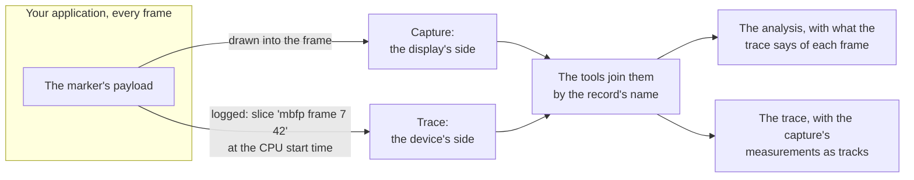

# Logging to a trace: the frame record with Perfetto

[The frame record](trace-frame-record.md) is the reference: every string, every rule. This guide shows how to log it with
[Perfetto's Tracing SDK](https://perfetto.dev/docs/instrumentation/tracing-sdk) in C++, how to record a trace that gets the most
out of it, and how to check what you logged. With the record in a trace of the run, the tools join the trace with the capture:
the capture's measurements become tracks in the trace, and what the trace says of each frame (its thread's scheduling, the
system's own account of it) goes into the analysis ([A capture and a Perfetto trace](../../measure/doc/perfetto.md)).

## The idea

A capture and a trace see the same run from two sides. The capture sees the display: when each frame appeared and for how long. A
trace sees the device: the application's threads and their scheduling, its present calls, the system's compositor and its own
account of every frame. Neither knows the other's frames, and their clocks are unrelated.



**The frame record is the bridge.** For every frame whose marker it draws, the application logs one slice named after the
marker's two ids (`mbfp frame <run id> <frame index>`), starting at the marker's CPU start time. The tools find each captured
frame's slice by its name, and place the whole run on the trace's clock by how far the slices start from the markers' CPU start
times. Then what the trace says of each frame (did its thread run or wait, what the system calls it) goes into the analysis, and
the capture's measurements go into the trace as tracks, next to the application's own. Nothing about the frames is guessed from
timing alone: the names say which frame is which.

**The start marker says a trace exists.** A capture can not show that a trace of the run was recorded. Set
`FM::MarkerFlags::FrameRecordLogged` on the run's start marker, and `analyze` and the GUI note it with the run, so whoever analyses
the capture later knows to ask for the trace. **The join works without it**: it stands on the record in the trace, not on the flag.
The flag only tells people.

## Before you start

The SDK's trace module (`mb_framepacing::trace`) works out what to log from the frame's marker; it calls no tracing API, so
the calls below are yours. They need Perfetto v49 or newer (`perfetto::NamedTrack`; [older SDKs](#an-older-perfetto-sdk) below).

## What the record needs from the marker

The record is a slice per frame **from the marker's CPU start time for its CPU busy time**, so the frames whose marker carries a
CPU start time get one, and the more of the marker you fill, the more the record carries ([Logging with the
marker](marker-logging.md)): the animation time always, then the preferred and target frame time, the refresh period and the
intended display time where you fill them. Read the marker's times from **`CLOCK_MONOTONIC`** where the platform has it (Linux,
Android): it is Perfetto's clock 3 (`FrameRecordText::ClockId`), so the slices sit right on the system's own tracks.

## Set up Perfetto once

Perfetto's track events need their category declared. The record's category is `mbfp` (`FrameRecordText::Category`):

```cpp
// MbfpTracing.hpp
#include <perfetto.h>

PERFETTO_DEFINE_CATEGORIES(perfetto::Category("mbfp").SetDescription("mb-framepacing: the frame record and what happened around each frame"));
```

```cpp
// MbfpTracing.cpp: once in the program
#include "MbfpTracing.hpp"
#include <mb/framepacing/trace/FrameRecordText.hpp>

PERFETTO_TRACK_EVENT_STATIC_STORAGE();

static_assert(MB::FramePacing::Trace::FrameRecordText::Category == "mbfp", "the category the macros name");

void InitializeTracing()
{
  perfetto::TracingInitArgs args;
  args.backends = perfetto::kSystemBackend;   // record with the system's own data (below); kInProcessBackend for this program only
  perfetto::Tracing::Initialize(args);
  perfetto::TrackEvent::Register();
}
```

Perfetto's macros take the category as a literal, hence the `static_assert`: it fails to compile should the SDK's string ever
differ.

## Log the record every frame

After the frame's marker is made, from the same payload:

```cpp
#include "MbfpTracing.hpp"
#include <mb/framepacing/marker/payload/Payload.hpp>
#include <mb/framepacing/trace/FrameRecord.hpp>
#include <mb/framepacing/trace/FrameRecordText.hpp>
#include <mb/framepacing/trace/FrameRecordUtil.hpp>
#include <mb/framepacing/trace/TrackLanes.hpp>

namespace FP = MB::FramePacing;
namespace FM = MB::FramePacing::Marker;
namespace FT = MB::FramePacing::Trace;

FT::TrackLanes g_recordLanes;   // one for the run's records: Clear() when a run starts

void LogFrameRecord(const FM::Payload& payload)
{
  FT::FrameRecord record;
  if (!FT::FrameRecordUtil::TryCreate(payload, g_recordLanes, record))
  {
    return;   // a sync marker, or no CPU start time: no record
  }
  // A track named "mbfp frames" under this process, the record's lane its id: lane 0 unless frames overlap
  const perfetto::NamedTrack track(perfetto::StaticString{FT::FrameRecordText::TrackName.data()}, record.Lane);
  TRACE_EVENT_BEGIN("mbfp", perfetto::DynamicString{record.Name.CStr()}, track,
                    perfetto::TraceTimestamp{FT::FrameRecordText::ClockId, record.StartTime.UnsignedNanoseconds()},
                    [&](perfetto::EventContext context)
                    {
                      for (const FT::FrameRecordAnnotation& annotation : record.Annotations())
                      {
                        context.AddDebugAnnotation(annotation.Name.data(), annotation.Value);
                      }
                    });
  TRACE_EVENT_END("mbfp", track, perfetto::TraceTimestamp{FT::FrameRecordText::ClockId, record.EndTime().UnsignedNanoseconds()});
}
```

- **The times are the marker's**, given to Perfetto as they are: the slice begins at the CPU start time and ends CPU busy later.
  The tools then find no difference at all between the record and the markers they decode ([checking it](#check-what-you-logged)).
- **The lane keeps overlapping frames apart.** For example, a frame started every millisecond that takes 1.5 ms of CPU work:

  ```mermaid
  gantt
      dateFormat x
      axisFormat %-S.%L ms
      section Lane 0
      mbfp frame 7 1 :0, 1500
      mbfp frame 7 3 :2000, 3500
      section Lane 1
      mbfp frame 7 2 :1000, 2500
      mbfp frame 7 4 :3000, 4500
  ```

  Why it matters: a track's slices must follow each other or nest, since Perfetto pairs a slice's end with
  the slice opened last, so two slices that overlap on one track end each other's, the lengths come out wrong, and the trace
  processor counts no error. A loop that makes its frames one after the other never overlaps them, and every record gets lane 0:
  one track. A pipelined engine (the next frame's CPU work starts before this frame is presented) gets a further lane for each
  frame that overlaps, as `TrackLanes` works out ([the lanes](trace-frame-record.md#frames-that-overlap-the-lanes)). Perfetto's
  viewer shows the tracks of one name as one track, and the tools read the record from every track of that name. Should
  `g_recordLanes.Overflows()` ever be above 0, more than 16 frames overlapped at once.

- **The names are the module's**: the slice's name (`mbfp frame <run id> <frame index>`, held inline in the record, nothing
  allocated) and the track's are string literals of `FrameRecordText`, so `StaticString` takes them, and so is every
  annotation's, which `AddDebugAnnotation` takes as it is.
- **Log it as soon as the marker is made**, in the frame. The slice's start lies a CPU busy time in the past, which Perfetto
  takes; a record logged much later (at the end of the run, say) can land behind what the trace already wrote, and a reader drops
  it.
- **Say so in the start marker**: set `FM::MarkerFlags::FrameRecordLogged` on the run's start marker, so whoever analyses the
  capture knows a trace of it exists ([the frame record](trace-frame-record.md#say-so-in-the-start-marker)).

### Where only a section can be logged

A writer that can only begin and end a section on the thread, at the moment it calls (Android's `ATrace_beginSection` and
`ATrace_endSection`, say), logs the record live: it begins the section named `record.Name.CStr()` when the frame's CPU work starts
and ends it when the present is called. That is the record "on the thread's own track" the reference allows. It carries no
annotations, and its times are close to the marker's, not equal: the tools' check says how close. Prefer the timed slice above
wherever the Tracing SDK is there.

## Log what happened around each frame (optional)

[Part 2](trace-frame-record.md#part-2-what-happened-around-each-frame-optional) adds the waits before a frame, its present, the
GPU's work and the platform's display time, each on a track of its own, and moments for the run. The tools do not check it
against the capture; it is what the application says it did, for whoever reads the trace and for the script that says what went
wrong in a run (`tools/trace_diagnose.py`). Log what you have and leave out the rest.

```cpp
#include <mb/framepacing/trace/FrameDetail.hpp>
#include <mb/framepacing/trace/FrameDetailName.hpp>
#include <string_view>
#include <utility>

// A slice of part 2 for one frame, on its track: the detail's name with the frame's two ids, its own times on CLOCK_MONOTONIC.
// rLanes: the lanes of that track (one TrackLanes per track name), as the GPU's work on frames in flight can overlap
template <typename TAnnotate>
void LogFrameDetail(const FT::FrameDetail detail, const std::string_view trackName, FT::TrackLanes& rLanes, const uint32_t runId,
                    const uint64_t frameIndex, const FP::NanosecondTickCount begin, const FP::NanosecondTickCount end, TAnnotate&& annotate)
{
  const FT::FrameDetailName name(detail, runId, frameIndex);
  const perfetto::NamedTrack track(perfetto::StaticString{trackName.data()}, rLanes.Assign(begin, end));
  const uint64_t beginNs = begin.UnsignedNanoseconds();
  const uint64_t endNs = end.UnsignedNanoseconds();
  TRACE_EVENT_BEGIN("mbfp", perfetto::DynamicString{name.CStr()}, track,
                    perfetto::TraceTimestamp{FT::FrameRecordText::ClockId, beginNs}, std::forward<TAnnotate>(annotate));
  TRACE_EVENT_END("mbfp", track, perfetto::TraceTimestamp{FT::FrameRecordText::ClockId, endNs});
}

// The present call: from the call to its return, with what it was given and what it returned
FT::TrackLanes g_presentLanes;
LogFrameDetail(FT::FrameDetail::Present, FT::FrameRecordText::PresentTrackName, g_presentLanes, runId, frameIndex, presentCall, presentReturn,
               [&](perfetto::EventContext context)
               {
                 context.AddDebugAnnotation(FT::FrameRecordText::SwapInterval.data(), swapInterval);
                 context.AddDebugAnnotation(FT::FrameRecordText::Result.data(),
                                            FT::FrameRecordText::PresentResultAccepted.data());
               });
```

Every name and value is a string of `FrameRecordText` ([the trace module](trace-frame-record.md#the-trace-module) and part 2's
tables): never a graphics API's own word, but `platformFeatures`, the plain list of the extensions and protocols found. The
display time is a moment, not a slice (`TRACE_EVENT_INSTANT` on the track `mbfp display`), as are the run's moments on
`mbfp run`: log `mbfp environment` when the run starts and again whenever one of its values changes.

## Record a trace that gets the most out of it

The record alone is enough to join; what the trace has beside it is what the tools can add. A config for Perfetto's command line
tool on Linux or Android (`perfetto --txt -c mbfp.pbtx -o run.pftrace`), with your program initialized with the system backend:

```
buffers { size_kb: 131072 fill_policy: RING_BUFFER }
# The frame record and part 2; add your own categories
data_sources { config { name: "track_event" track_event_config { enabled_categories: "mbfp" } } }
# Your threads' scheduling: the tools hold each frame's CPU busy time against it
data_sources {
  config {
    name: "linux.ftrace"
    ftrace_config { ftrace_events: "sched/sched_switch" ftrace_events: "sched/sched_waking" }
  }
}
# The process and thread names
data_sources { config { name: "linux.process_stats" process_stats_config { scan_all_processes_on_start: true } } }
# Android: the system's own account of every frame, which the tools match to the capture's
data_sources { config { name: "android.surfaceflinger.frametimeline" } }
duration_ms: 120000
```

| Data in the trace                     | What the tools do with it                                                                                                     |
| ------------------------------------- | ----------------------------------------------------------------------------------------------------------------------------- |
| The frame record (`mbfp`)             | Places the run in the trace and joins every frame to it; the run's markers are checked against it, value by value             |
| Scheduling (`sched_switch`, `waking`) | For each frame's CPU busy time: how long its thread ran, waited for a CPU, or slept                                           |
| Android's frame timeline              | The system's account of each frame (its present type and jank), and the measured display time minus the system's present time |
| Part 2                                | Counted by `trace-info`, read by `tools/trace_diagnose.py`                                                                    |

Start the recording before the run's start marker and stop it after the end marker. Record the capture of the same run as you
always do ([usage](../../measure/doc/usage.md)); the clocks of the two are tied by the frames.

## Check what you logged

```sh
mb-framepacing trace-info run.pftrace                                    # the processes, the frame records found, part 2 counted
mb-framepacing analyze <capture folder> --trace-app run.pftrace          # the record held against the markers, nothing joined
mb-framepacing analyze <capture folder> --trace run.pftrace --charts     # the join, with the augmented trace
```

`analyze` prints the check and writes it next to the run as `run-<id>-trace-check.txt`
([do they line up](../../measure/doc/perfetto.md#do-they-line-up)). For a record logged as above, from the payload:

- every frame with a CPU start time has a slice;
- the slices start at the markers' CPU start times, all at one offset from them (0 when the marker's times are
  `CLOCK_MONOTONIC`), and none elsewhere;
- no slice's length differs from its marker's CPU busy time;
- no annotation differs from its marker's value.

Anything else is a finding: a marker decoded as another frame's, a value lost on the way, a clock that is not the marker's. A
record logged live around the work (the section form) shows its differences here, as numbers.

## An older Perfetto SDK

Before v49 there is no `perfetto::NamedTrack`. Give each lane a track of your own, named once when it is first used, and use it in
place of the named track above (`FrameTrack(record.Lane)`):

```cpp
#include <array>

// The track of a lane: an id of your own per lane, under this process, named "mbfp frames"
perfetto::Track FrameTrack(const uint32_t lane)
{
  static std::array<bool, FT::TrackLanes::MaxLaneCount> named{};
  const perfetto::Track track(0x6d626670u + lane);
  if (!named[lane])
  {
    auto descriptor = track.Serialize();
    descriptor.set_name(FT::FrameRecordText::TrackName.data());
    perfetto::TrackEvent::SetTrackDescriptor(track, descriptor);
    named[lane] = true;
  }
  return track;
}
```
